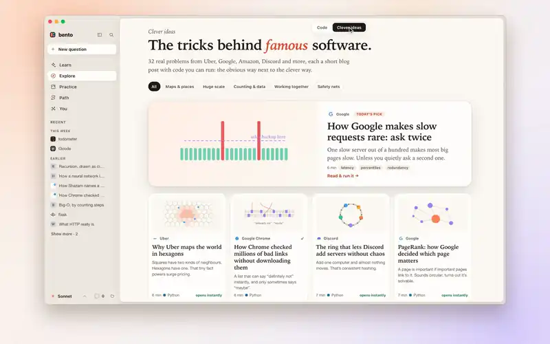
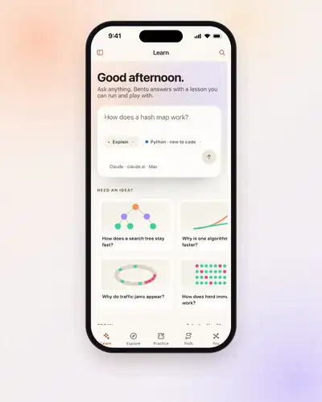

<p align="center"></p>

<h1 align="center">Bento</h1>

<p align="center"><b>Learn how software is really built.</b><br>Ask anything and get a lesson you can run. Take apart any app.<br>With the AI you already pay for.</p>

<p align="center">
  <a href="https://github.com/lhz56/bento-releases/releases/latest/download/Bento-arm64.dmg"><b>Download for Mac</b></a> ·
  <a href="https://github.com/lhz56/bento-releases/releases/latest/download/Bento-x64.dmg">Intel</a> ·
  <a href="docs/FEATURES.md">Everything it does</a> ·
  <a href="LICENSE">MIT</a>
</p>

<p align="center"></p>

## Get started

1. **[Download Bento](https://github.com/lhz56/bento-releases/releases/latest/download/Bento-arm64.dmg)** (Apple Silicon) or the [Intel version](https://github.com/lhz56/bento-releases/releases/latest/download/Bento-x64.dmg). macOS 13 or newer.
2. Drag it into Applications and open it.
3. Pick the AI you already use. That's it.

Signed and notarized by Apple, and it updates itself.

## Ask anything. Get a lesson you can run.

Real code on the right, the story on the left, every line in plain English. Run it, change a number, watch the picture change.

<p align="center"></p>

## Take apart any app

Paste a GitHub link. Bento draws the whole app as one picture: every part, what it does, how the parts talk, and the real word for each. Then a code city, the tools it uses (and why), and where it's fragile.

<p align="center"></p>

## Practice by doing

34 interview puzzles raced from ten items to a billion, 32 famous engineering tricks you can run (Uber, Discord, Google…), seven learning paths, and playgrounds for SQL, Git and system design.

<p align="center"></p>

## On your iPhone and iPad



Your Mac does the work; your phone goes anywhere.

1. On your Mac: **Settings → Your phone and iPad**.
2. On your phone: scan the code, or open the Bento Code app and tap **Allow** on your Mac.
3. Learn from the couch or the train, over [Tailscale](https://tailscale.com) or your Wi-Fi.

Nothing is hosted. Your phone talks only to your own Mac. More in [docs/PHONE.md](docs/PHONE.md).

<br clear="right">

## Works with the AI you already have

| AI | What Bento uses | Plan |
|---|---|---|
| Claude | Claude Code (`claude`) | Claude Pro or Max |
| ChatGPT | Codex (`codex`) | ChatGPT Plus, Pro or Business |
| Gemini | Antigravity (`agy`) or Gemini CLI (`gemini`) | Google AI Pro (free for students), or a Gemini API key |
| GitHub Copilot | Copilot CLI (`copilot`) | Free with GitHub |

Any one is enough. No API keys and no account: Bento drives the official tool already signed in on your Mac, with all of its tools switched off, so the model can only write text. Missing one? Bento installs it for you in Terminal, where you can see every step. A meter in the sidebar shows how much of your plan you've used.

**Or let your own agent drive Bento** (next release). Add Bento to Claude Code, Codex, Gemini or Copilot from **Settings → Use Bento from your AI agent**, then say *"show me in Bento"*. Your agent gets four tools: show a lesson, see what you're looking at, point at lines, run code. See [docs/ARCHITECTURE.md](docs/ARCHITECTURE.md#your-own-agent-uses-bento-mcp).

## Private by design

- Your code runs on your Mac. Python is real CPython in WebAssembly, in a sandbox.
- Apps you take apart are only read, never run.
- What leaves your Mac: questions to your own AI, and the GitHub pages or websites you ask for. No telemetry, no analytics, no account.
- Phone access is off until you turn it on, and only paired devices get in. See [Safety](docs/PHONE.md#safety) and [docs/ARCHITECTURE.md](docs/ARCHITECTURE.md#safety).

## Build it yourself

```bash
git clone https://github.com/lhz56/bento && cd bento
npm install
npm run dev      # the app, with hot reload
npm test         # none of the checks use an AI plan
npm run smoke    # the real app, hidden, used end to end
```

You need Node 20+ and at least one of `claude`, `codex`, `gemini` or `copilot` signed in. How it fits together: [docs/ARCHITECTURE.md](docs/ARCHITECTURE.md). Shipping a release: [docs/RELEASING.md](docs/RELEASING.md). The pictures above come from `scripts/record-media.mjs` and `scripts/record-phone.mjs`, which film the real app with a pretend AI.

## Contributing

Ideas, puzzles, tools for the catalog and fixes are all welcome. Start with [CONTRIBUTING.md](CONTRIBUTING.md). Found a problem? [Open an issue](https://github.com/lhz56/bento-releases/issues).

MIT licensed. Made to be read, forked and learned from.
