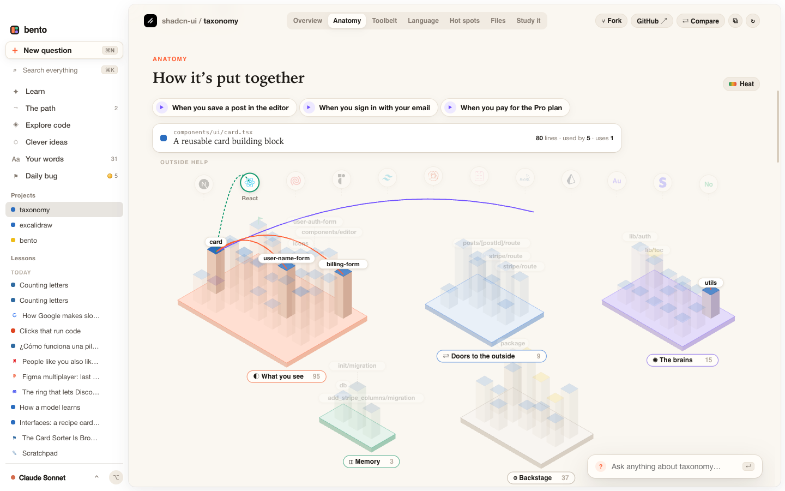
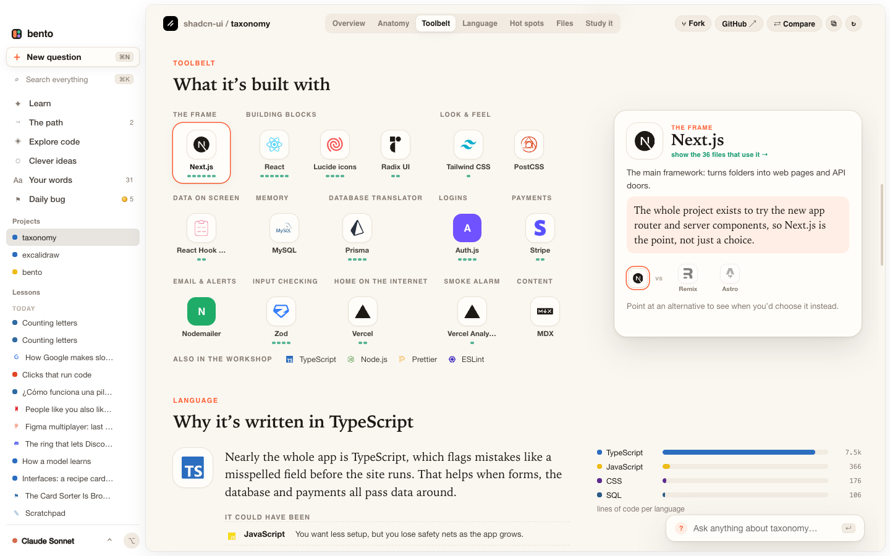
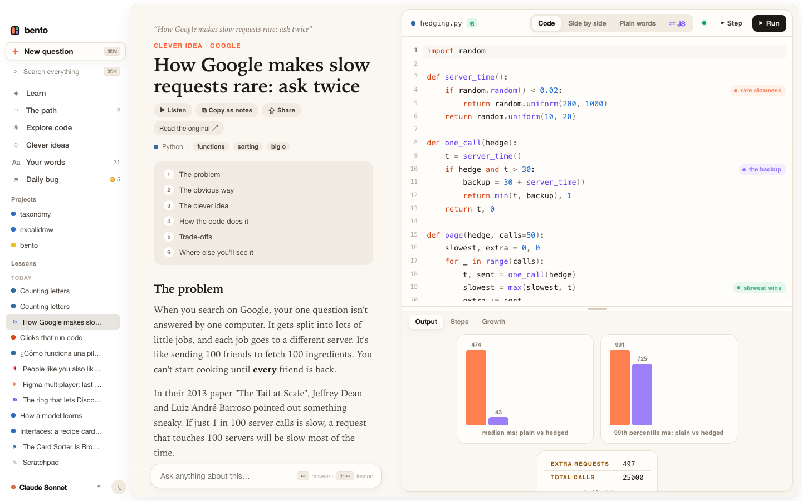
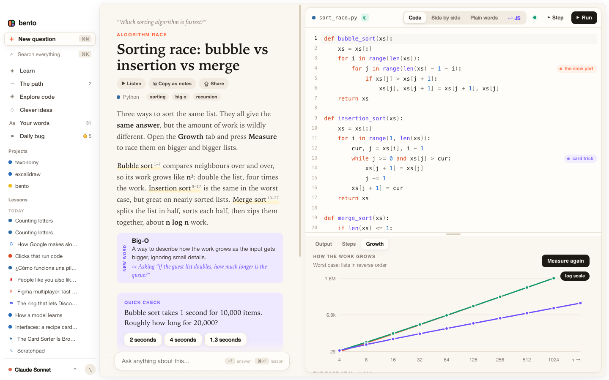
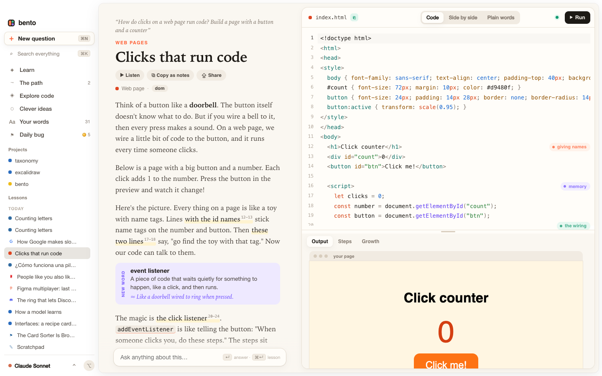
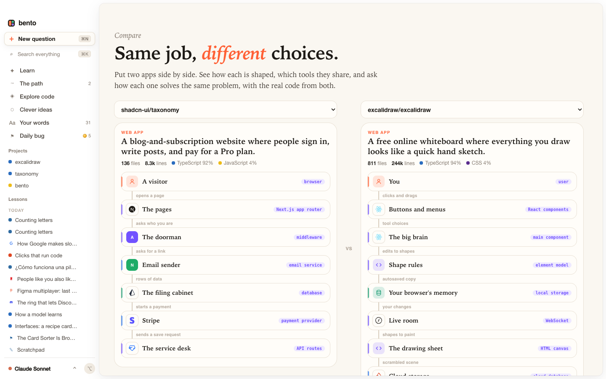
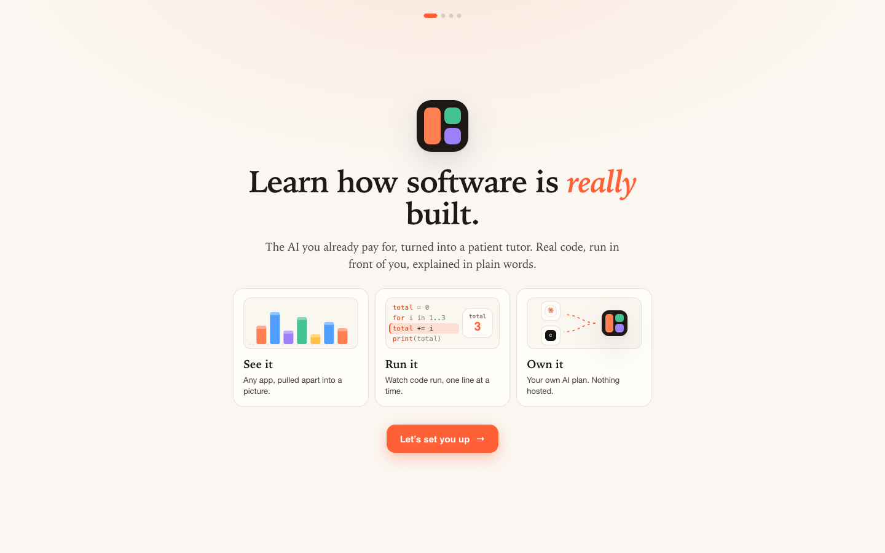
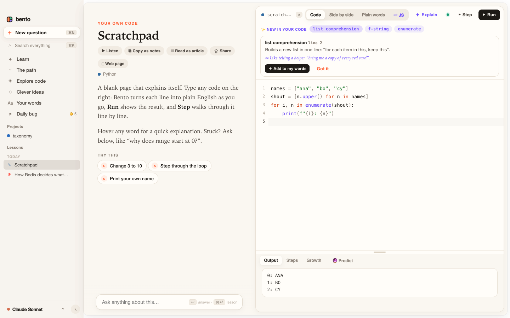
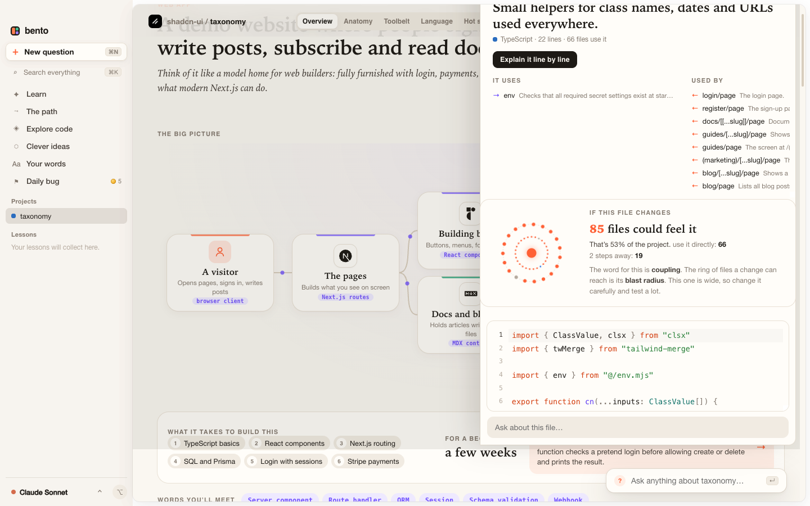

<p align="center"></p>

# Bento

**Learn how software is really built, with the AI subscription you already pay for.**

Bento is a small Mac app that works like a patient tutor. Ask it anything and you get a lesson with real code you can run, change and step through, with every line explained in plain English. Point it at any GitHub project and it draws the whole app as one picture you can read, even if you've never programmed.

It drives the **Claude Code** or **Codex** command-line tools that are already signed in on your Mac. There's nothing to host and no API keys, and Bento never sees your account.


<table>
<tr><td></td><td></td></tr>
<tr><td></td><td></td></tr>
<tr><td></td><td></td></tr>
<tr><td></td><td></td></tr>
<tr><td></td><td></td></tr>
<tr><td></td><td></td></tr>
<tr><td></td><td></td></tr>
</table>

---

## What's inside

| | |
|---|---|
| **Learn** | Ask a question and get a lesson that streams in: the explanation on the left, live code on the right. Phrases link to the lines they talk about. |
| **Three lenses** | *Code*, *Side by side* (each line next to its plain-English meaning) and *Plain words* (pseudocode first, code underneath). |
| **Pictures from code** | `show(x)` draws whatever you give it: bars, trees, tables, record lists as real tables, and grids of a few values as coloured squares (forests, mazes, game boards). Canvas helpers draw art. |
| **Run, Step, Growth** | Real Python (Pyodide), JavaScript and TypeScript run locally. TypeScript is checked by the real compiler as you type, so type errors show up on the right line before anything runs. Step through line by line with variables and the call stack, or measure how the step count grows (Big-O). |
| **Hover anything** | Point at any word (`const`, `.split`, your own function names) for a small explanation card. |
| **What changed?** | Edit the code, then ask Bento to explain your change in plain words, bugs included. |
| **✨ New in your code** | As you write, Bento spots constructs you haven't met yet (list comprehensions, f-strings, arrow functions, `?.`, `async/await`…) and explains each one instantly, with an everyday comparison. No AI needed. |
| **Errors that explain themselves** | The most common Python and JavaScript errors get a plain "what happened" and "try this" right away, offline. JavaScript habits in Python are caught too (`push` → `.append`). |
| **🔮 Predict, then run** | Guess what the code will print before running it. Bento colours the lines you got right and points at the exact line that surprised you. |
| **Explain it back** | At the end of a lesson, explain the idea in your own words. Your AI says what you got, what's missing, and asks one question that pushes further. |
| **Scratchpad** | A blank page that translates your own code into English as you type. |
| **Explore code** | Search open source (shelves like *Discord bots* and *Tiny games*, each with a "how long to read" badge), paste any GitHub link, or open your own repos and folders. |
| **Atlas** | Any repo, taken apart:<br>• **The big picture**: an animated flow of the whole system, with each part's plain name, what it does and the real technical word for it. Click any part to go deeper, or press *Walk me through it* to hear it explained part by part.<br>• **Code city**: layers are districts, files are buildings (height = how much code), roofs show the language, and outside services float above. Hover to see who talks to whom, or play a *journey* through a real user action.<br>• **Toolbelt**: every tool with its real logo, why this project picked it, and "Pick X when…" for each alternative.<br>• **Hot spots**: fragile hubs, giant files, import loops, missing tests and bottlenecks found by reading the code.<br>• **Files**: a map of every file (a treemap sized by code, coloured by layer) and a list with a one-line job for each. Open any file, explain it line by line, ask about it, or see **how other open-source projects write the same thing**, side by side. |
| **Take apart a website** | Paste any URL (stripe.com, nytimes.com…). Bento visits it like a browser, spots what it's built with from headers and scripts (WordPress, Shopify, Next.js, Cloudflare, Fastly, Stripe, analytics…), and explains the trip from your keyboard to the pixels, step by step. |
| **Compare** | Two apps side by side: their pictures, the tools they share, the tools only one uses, and lessons that compare how each solves the same problem using real code from both. |
| **Clever ideas** | Famous engineering tricks written as blog posts you can run (32 of them, pre-written so they open instantly): Uber's hexagons, Chrome's Bloom filter, Discord's hash ring, PageRank, Snowflake IDs, Stripe's rate limits and idempotency keys, Reddit's view counting, Git's Merkle trees, Figma multiplayer, Shazam fingerprints, Spotify's shuffle, MapReduce, Redis eviction, WhatsApp's key exchange and more. Each one runs the obvious way and the clever way side by side, so you *see* why it wins. |
| **The path** | Three tracks you can follow in order: *Zero to a real app*, *How the web works* (live web pages) and *AI from scratch* (from a guessing machine to attention). Every path lesson and every clever idea ships pre-written, so they open instantly, even before you connect an AI. **Make your own path**: type any goal ("learn SQL") and Bento designs a track for you. |
| **Algorithm races** | Sorting, searching, Fibonacci and counting: two or three algorithms race live on growing inputs, with a log-scale chart, the Big-O detected for each, and a finish line ("60× more work"). Opens instantly; no model needed. |
| **Build a mini version** | Every Atlas suggests a tiny runnable version of the app (for example "a 40-line alert router"). Bento builds it with you step by step; each step runs and shows a diff. |
| **Ripple and code detective** | Every file in an Atlas shows its *ripple*: the rings of files that would feel a change to it (coupling and blast radius, as a picture). *Code detective* shows the top of real files and you guess what each one does. |
| **Find this in real code** | After a lesson, search GitHub for real projects that use the same idea, then open one in the Atlas with that exact file already open. |
| **Select to explain** | Highlight any text (in a lesson, the code or an Atlas) and press *Explain*. |
| **Remix / Simpler / Deeper** | Copy any lesson's code into your own scratchpad; ask for the same lesson simpler or deeper. |
| **Ask anything, inline** | In any lesson, or about any repo or website, press ↵ for a short answer right in the conversation (with links that light up the code), or ⌘↵ to turn it into a full lesson. **Second opinion** asks your other AI (Codex ↔ Claude) the same question, so you can see where they disagree. |
| **Pictures for systems** | Questions like "how does email work?" come with an animated diagram of the whole system, each part labelled in plain words and with its real technical name. |
| **Simulate anything** | "Why do traffic jams appear from nowhere?", "How does herd immunity work?": general questions become small simulations you can run and tweak. |
| **Share as a web page** | Save any lesson as one self-contained `.html` blog post that anyone can open in a browser, with code they can edit and run (Python via Pyodide), drawings and quizzes. |
| **Listen** | Any lesson can be read aloud with your Mac's own voice. |
| **Your language** | Lessons, answers, pictures and pseudocode in 22 languages (Español, 中文, हिन्दी, العربية, Kiswahili…). Code stays in English so it runs everywhere. |
| **Web pages** | HTML/CSS/JS lessons render live in a sandboxed preview on its own origin, with the page's console shown underneath. Point at anything on the page to light up the line of code that made it. Change a colour and watch it update, then **Save my page** to keep it as a real .html file. |
| **TypeScript** | Alongside Python and JavaScript. Bento type-checks as you type with the real compiler and runs it instantly. |
| **Your words** | Every technical word a lesson introduces is saved with a plain definition. Review them as flashcards. |
| **⌘K · ⌘, · ?** | One box for everything (⌘K), settings (⌘,), and a shortcut sheet (?). The ⌘K box: ask a question, paste a repo, or jump to any lesson, project, idea or word. |
| **Daily bug** | A broken function, tests shown as lights, and hints that cost coins. |

## How it connects to your AI (no keys)

On first launch Bento looks for what's already on your Mac:

- `claude auth status` checks Claude Code (Pro or Max subscription).
- `codex login status` checks Codex (ChatGPT Plus or Pro).
- `gh` checks GitHub. This one is optional; it unlocks your repos, private ones included.

It routes to whatever is signed in: Sonnet for lessons and Haiku for quick answers, or Codex. If something is missing, it shows the exact command to copy into Terminal. You can switch models at any time from the sidebar. If one AI hits its usage limit or is signed out, Bento quietly routes the request to the other one and tells you.

Bento never stores tokens. Every request is a call to your own CLI (for example `claude -p … --tools ""`), with tools disabled so the model can only write text.

## Privacy

- Code runs on your Mac. Python is real CPython compiled to WebAssembly, running in a worker.
- Repos are shallow-cloned into `~/Library/Application Support/bento/repos` and analysed locally.
- What leaves your machine: prompts sent to your own model CLI, GitHub and website requests you ask for, and Pyodide package downloads when lesson code imports something like numpy. No telemetry.
- Repo code is only read, never run, and lesson web pages run on an isolated origin. See [Safety](docs/ARCHITECTURE.md#safety).

## Run it

```bash
npm install
npm run dev      # Vite + Electron with hot reload
npm run app      # build Bento.app into release/
npm test         # runtime tests (instrumentation, stepping, loop guard)
npm run dist     # a .dmg + .zip to share (unsigned: right-click → Open the first time)
```

You need Node 20+, plus `claude` and/or `codex` installed and signed in. `gh` is optional.

## Project layout

For how the pieces fit together (streaming lessons, the code runners, the Atlas pipeline), see [docs/ARCHITECTURE.md](docs/ARCHITECTURE.md).

```
electron/main.cjs      window, model CLIs (streaming, thinking), subscription scan, GitHub, Atlas IPC
electron/atlas.cjs     shallow clone + static analysis: layers, imports, manifests, entry points
electron/prompts.cjs   lesson, case-study and atlas formats (NDJSON blocks)
src/lesson.js          lesson model, streaming parser, prompt builders, built-in lessons
src/ideas.js           the clever-ideas library (facts each lesson must stay inside)
src/atlas/             tool catalog (190+ tools, logos via simple-icons), stack detection, hot spots
src/ui/                Home, Story, Desk/Editor/Stage, Explore, Atlas, BigPicture, City, Compare, Ideas, Words, Palette, Onboarding
src/runtime/           JS worker (step tracing), Python worker (settrace), TypeScript checker worker
```

## Contributing

See [CONTRIBUTING.md](CONTRIBUTING.md). The easiest places to start: add a clever idea, add a tool to the catalog, or improve how a layer is detected.

MIT licensed.
