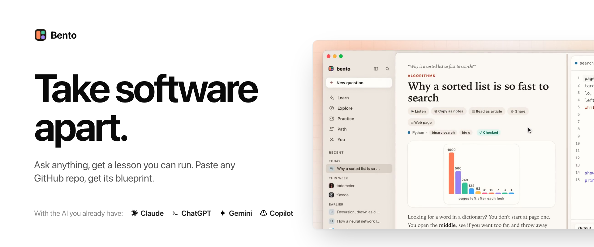
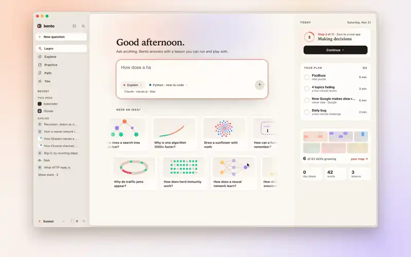
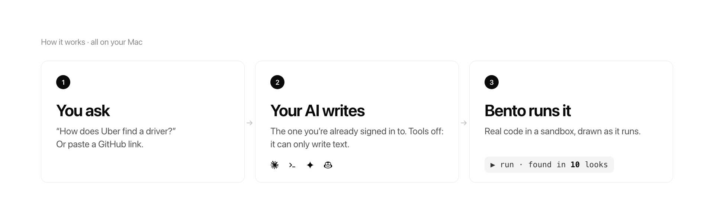
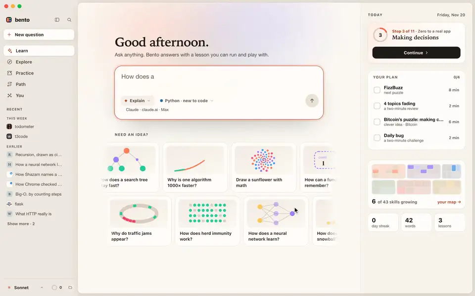
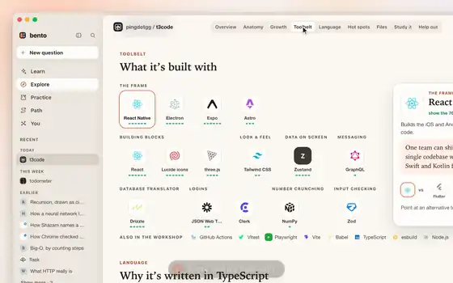
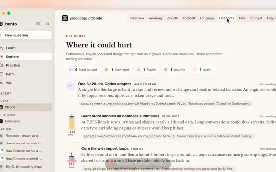
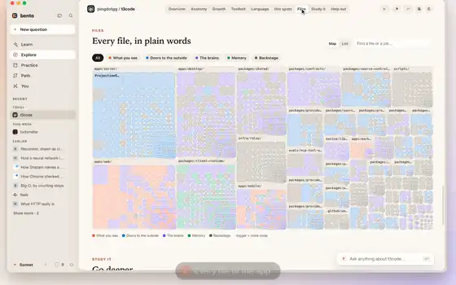
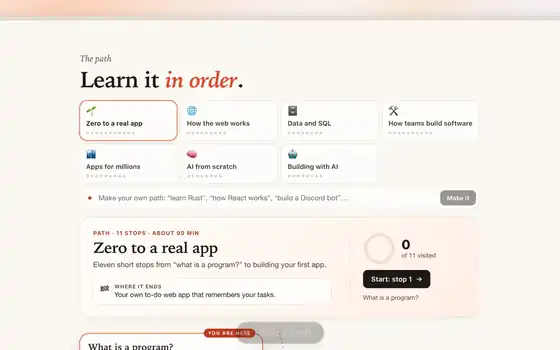
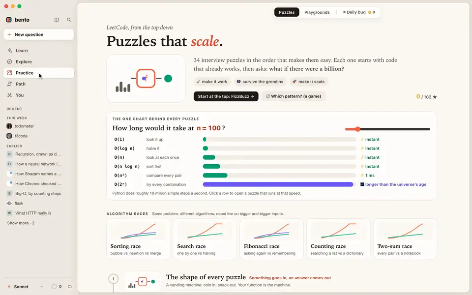
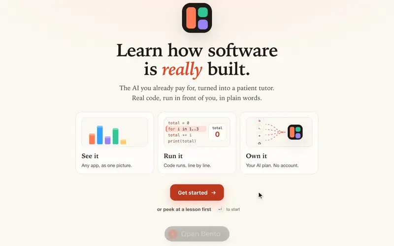

<p align="center"></p>

<h3 align="center">Ask anything, get a lesson you can run.<br>Paste any GitHub repo, get its blueprint.</h3>

<p align="center">A free, open-source Mac app that teaches how real software is built, using the Claude, ChatGPT, Gemini or Copilot plan you already have. No API key, no account.</p>


<p align="center">
  <a href="https://github.com/lhz56/bento-releases/releases/latest/download/Bento-arm64.dmg"></a>
  <a href="https://github.com/lhz56/bento-releases/releases/latest/download/Bento-x64.dmg"></a>
  <a href="LICENSE"></a>
</p>

<p align="center">
  
  
  
  
  
</p>

<p align="center"><sub>🤖 <b>Using an AI agent?</b> Paste this into Claude Code, Codex or Cursor: <code>Install Bento from github.com/lhz56/bento</code>. It follows <a href="AGENTS.md">AGENTS.md</a>.</sub></p>

<p align="center">
  <a href="https://takeitapart.app"><b>takeitapart.app</b></a> ·
  <a href="#learn">Learn</a> ·
  <a href="#take-apart">Take apart</a> ·
  <a href="#in-the-box">In the box</a> ·
  <a href="#your-ai">Your AI</a> ·
  <a href="#build-it-yourself">Build it</a> ·
  <a href="docs/FEATURES.md">Everything it does</a>
</p>

<br>

<p align="center"></p>

<br>

> **Why not just ask ChatGPT?** ChatGPT tells you. Bento shows you: the code runs, the picture moves, every line has plain words, and you can take apart real apps, not just toy examples.

## ▍Learn

### Every answer is a lesson you can **run**.

Ask *“How does Uber find a driver?”* and get the real idea: code you can run, a picture that moves, every line in plain English. Plus 32 famous engineering tricks from Uber, Discord and Google.

<p align="center"></p>

<p align="center"></p>

## ▍Take apart

### Paste a GitHub link. Get the blueprint.

The whole app as one picture. Click any part for the real word. Watch a request travel through a code city.

<p align="center"></p>

## ▍In the box

<table>
  <tr>
    <td width="50%" valign="top"><br><b>The toolbelt</b><br><sub>Every tool an app uses, and why it was picked.</sub></td>
    <td width="50%" valign="top"><br><b>Hot spots</b><br><sub>Where it could break, in plain words.</sub></td>
  </tr>
  <tr>
    <td width="50%" valign="top"><br><b>Every file</b><br><sub>Sorted by what it does. Find any one.</sub></td>
    <td width="50%" valign="top"><br><b>Paths</b><br><sub>Seven of them. Zero to a real app, in order.</sub></td>
  </tr>
</table>

**Puzzles that scale.** 34 interview puzzles, pushed from ten items to a billion, raced live.

<p align="center"></p>

## ▍Your AI

Any one is enough. Bento drives the official tool already signed in on your Mac, with its tools switched off, so the model can only write text.

| | Uses | Plan you already have |
|---|---|---|
|  **Claude** | `claude` | Pro or Max |
| **ChatGPT** | `codex` | Plus, Pro or Business |
|  **Gemini** | `agy` or `gemini` | AI Pro (free for students), or an API key |
|  **Copilot** | `copilot` | Free with GitHub |

Missing one? Bento installs it in Terminal, where you can watch every step.

<p align="center"></p>

## ▍Private by design

| | |
|---|---|
| **Your code** | Runs on your Mac. Python is real CPython in WebAssembly, in a sandbox. |
| **Apps you take apart** | Only read, never run. |
| **What leaves your Mac** | Your questions, to your own AI. The pages you ask for. Nothing else. |
| **Telemetry** | None. No analytics, no account. |

**On your iPhone and iPad:** coming soon.

## ▍Build it yourself

```bash
git clone https://github.com/lhz56/bento && cd bento
npm install
npm run dev      # the app, with hot reload
npm test         # no check ever spends an AI plan
npm run smoke    # the real app, hidden, end to end
```

Node 20+ and one signed-in AI CLI. Working with an AI agent? Point it at [AGENTS.md](AGENTS.md). How it fits together: [ARCHITECTURE](docs/ARCHITECTURE.md) · Shipping: [RELEASING](docs/RELEASING.md) · Help out: [CONTRIBUTING](CONTRIBUTING.md) · Problems: [issues](https://github.com/lhz56/bento/issues) · Security: [SECURITY](SECURITY.md)

<sub>Every clip here is the real app, filmed by <code>scripts/record-media.mjs</code> with a pretend AI and finished by <code>scripts/compose-media.mjs</code>.</sub>

<br>

<p align="center"><a href="https://github.com/lhz56/bento-releases/releases/latest/download/Bento-arm64.dmg"></a></p>

<p align="center"><b>⭐ Star the repo to follow along.</b> New lessons, new puzzles, and Windows and iPhone on the way.</p>

<p align="center"><sub>Made by <a href="https://github.com/lhz56">Lin Zaw</a> · MIT</sub></p>
