<p align="center"></p>

# Bento

**Learn how software is really built, with the AI subscription you already pay for.**

Bento is a small Mac app that works like a patient tutor. Ask it anything and you get a lesson with real code you can run, change and step through, with every line explained in plain English. Point it at any GitHub project and it draws the whole app as one picture you can read, even if you've never programmed.

It drives the **Claude Code** or **Codex** command-line tools that are already signed in on your Mac. There's nothing to host and no API keys, and Bento never sees your account.

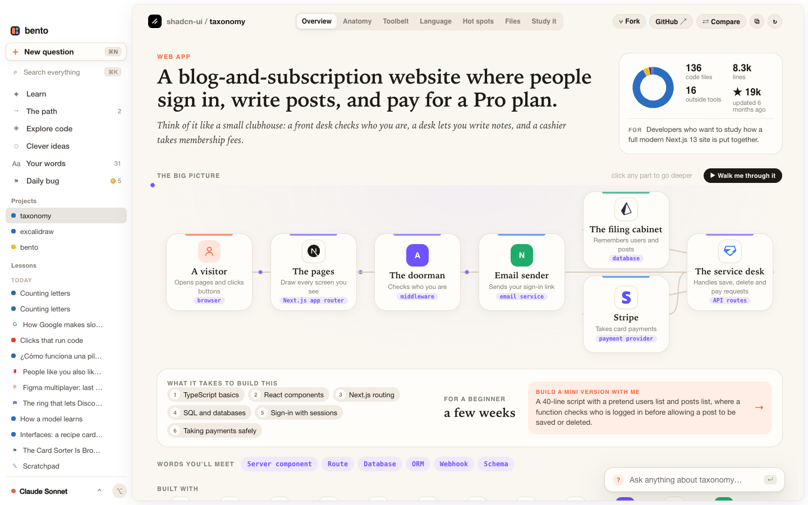

<table>
<tr><td colspan="2">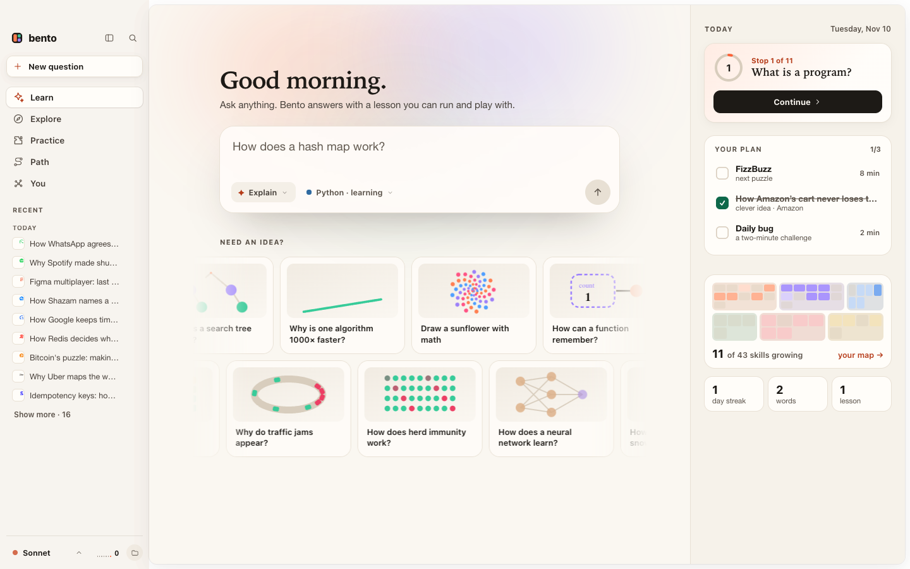</td></tr>
<tr><td></td><td>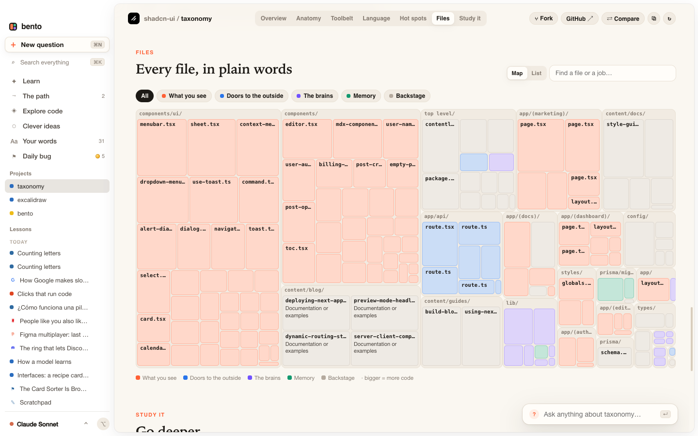</td></tr>
<tr><td></td><td>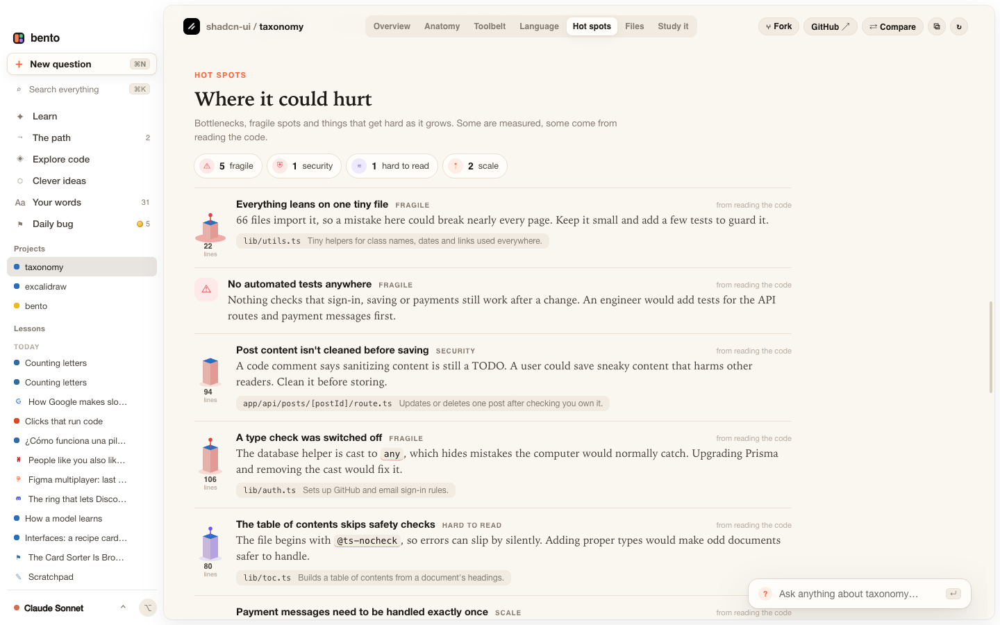</td></tr>
<tr><td></td><td></td></tr>
<tr><td></td><td></td></tr>
<tr><td></td><td>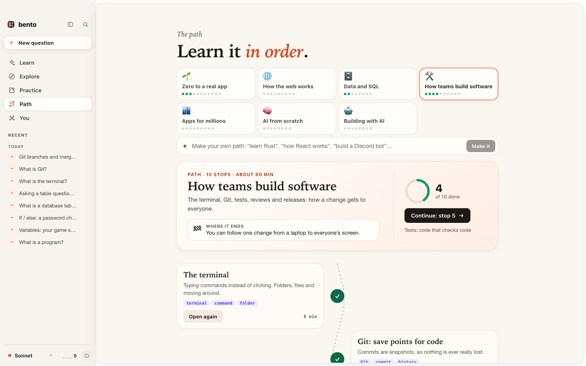</td></tr>
<tr><td>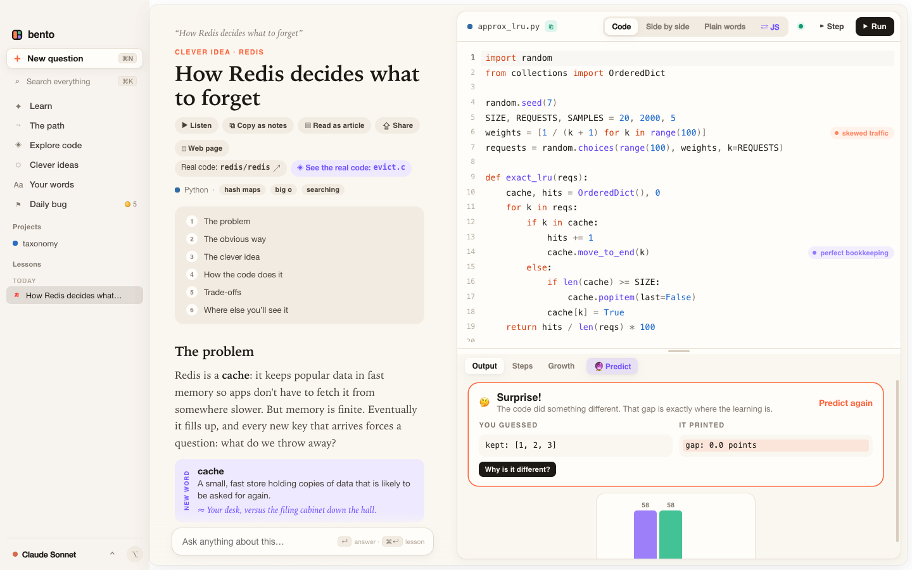</td><td></td></tr>
<tr><td>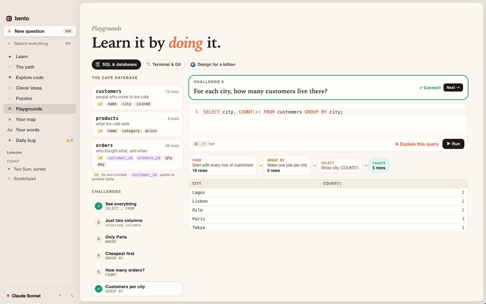</td><td>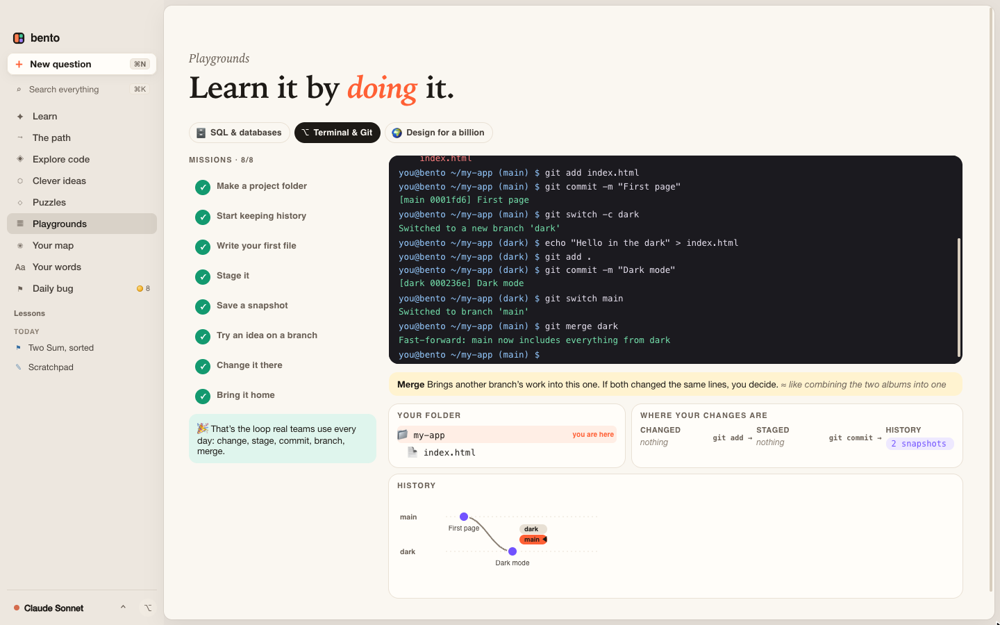</td></tr>
<tr><td>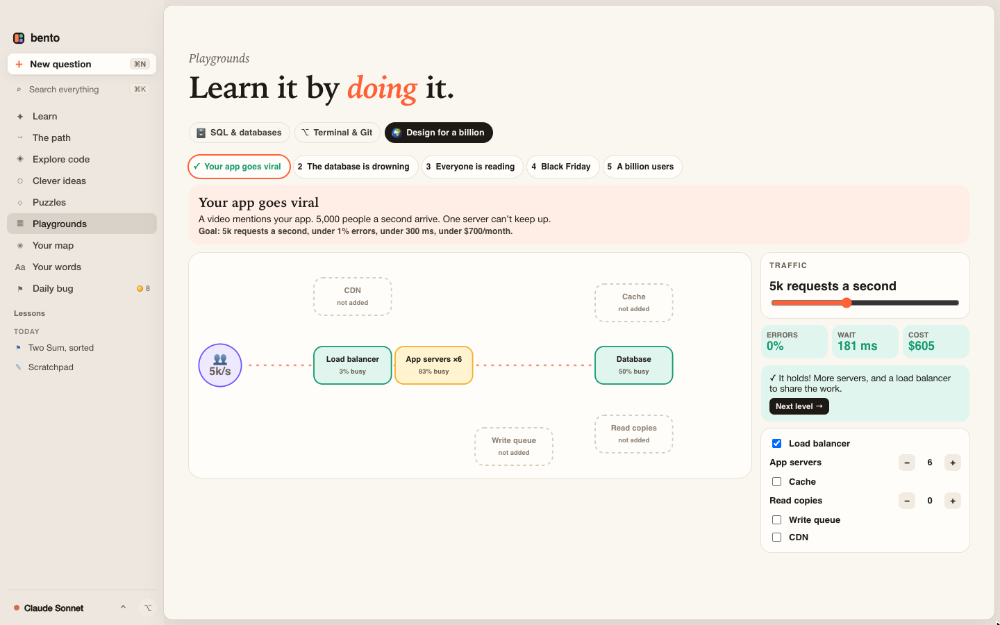</td><td>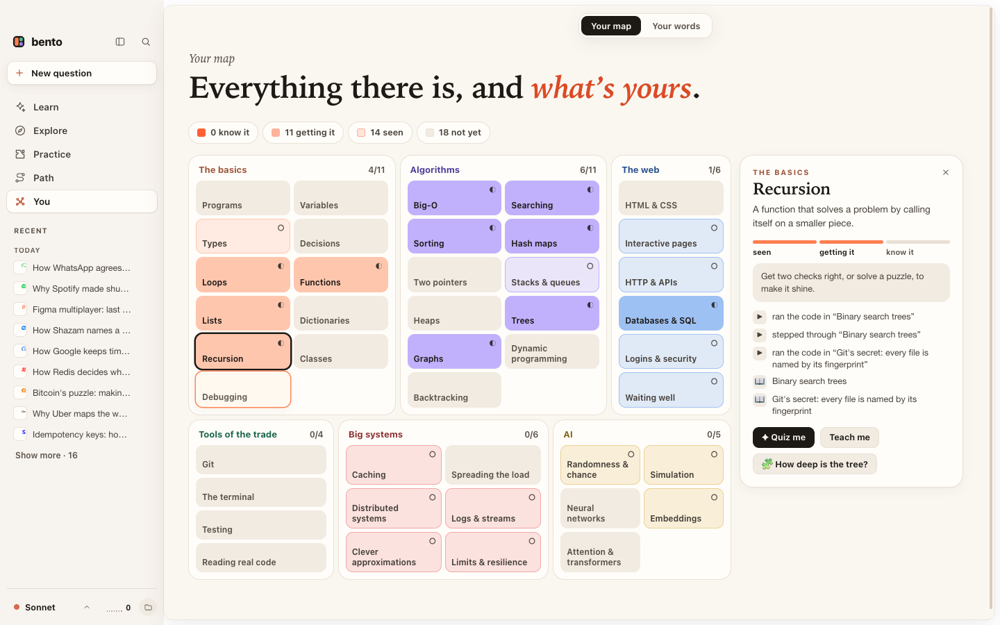</td></tr>
<tr><td>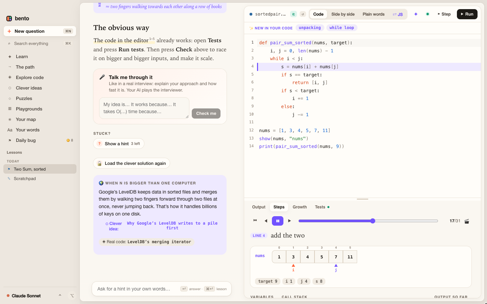</td><td>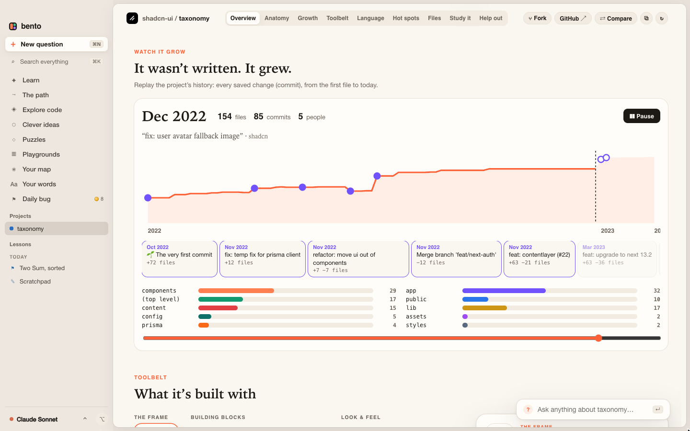</td></tr>
<tr><td colspan="2">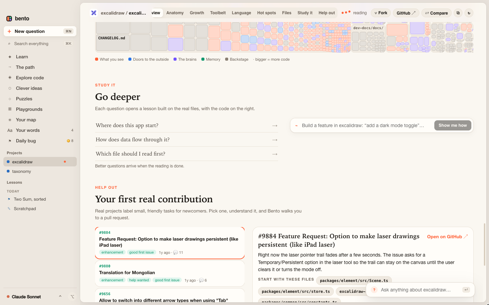</td></tr>
<tr><td>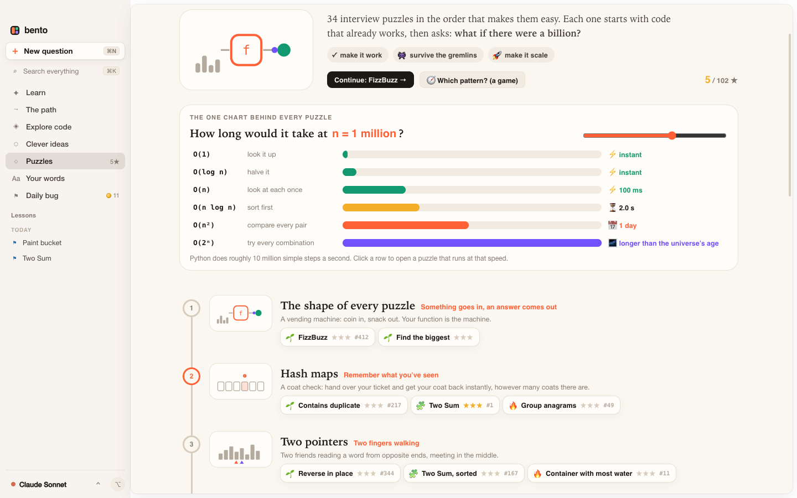</td><td>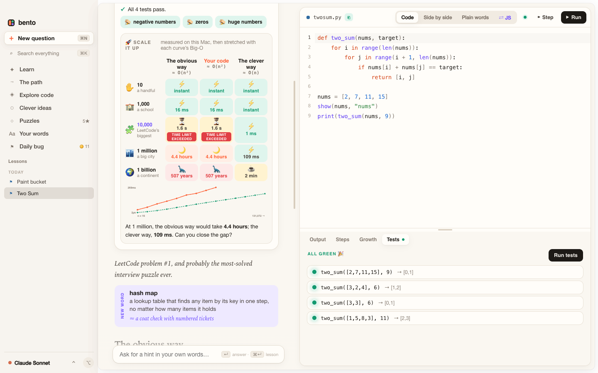</td></tr>
<tr><td></td><td>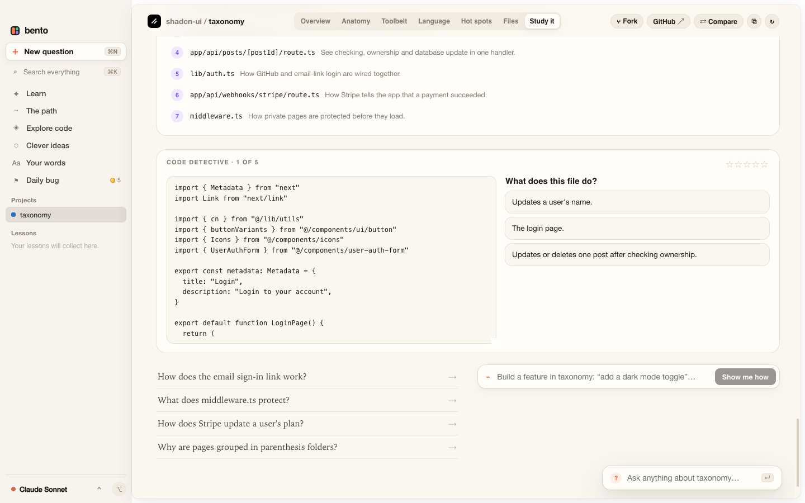</td></tr>
</table>

---

## Get it

1. Download **Bento for Mac** from [Releases](https://github.com/lhz56/bento/releases/latest): `arm64` for Apple Silicon (M1 and later), `x64` for Intel. macOS 12 or newer.
2. Open the `.dmg` and drag Bento into Applications.
3. Bento finds Claude Code or Codex if you have them, and shows the one command to install either if you don't. It updates itself from then on.

## What's inside

| | |
|---|---|
| **Learn** | Ask a question and get a lesson that streams in: the explanation on the left, live code on the right. Phrases link to the lines they talk about. |
| **Home** | One calm ask box, with ideas drifting underneath as tiny moving pictures (a search tree growing, cars bunching into a jam, a fire spreading) that open instantly. Beside it, *Today*: the next stop on your path, a short plan that ticks itself off, how your map is filling in and your streak. |
| **Sidebar** | Five places (Learn, Explore, Practice, Path, You), each with its own tabs, and your recent lessons and projects on a shelf grouped by day. Close it with ⌘\\ for a full-width lesson. Pick your model from cards that show how fast and how deep each one is. |
| **Answers you can use** | Every short answer ends with what to do next: *Simpler*, *Show an example*, *Make it a lesson*, follow-up questions, and sometimes a one-question check. The end of a lesson offers concrete next steps you can run, a deeper lesson, or *Prove it*. |
| **Three lenses** | *Code*, *Side by side* (each line next to its plain-English meaning) and *Plain words* (pseudocode first, code underneath). |
| **Pictures from code** | `show(x)` draws whatever you give it: bars, trees, tables, record lists as real tables, and grids of a few values as coloured squares (forests, mazes, game boards). Canvas helpers draw art. |
| **Run, Step, Growth** | Real Python (Pyodide), JavaScript and TypeScript run locally. TypeScript is checked by the real compiler as you type, so type errors show up on the right line before anything runs. Step through line by line with variables and the call stack, or measure how the step count grows (Big-O). |
| **Hover anything** | Point at any word (`const`, `.split`, your own function names) for a small explanation card. |
| **What changed?** | Edit the code, then ask Bento to explain your change in plain words, bugs included. |
| **✨ New in your code** | As you write, Bento spots constructs you haven't met yet (list comprehensions, f-strings, arrow functions, `?.`, `async/await`…) and explains each one instantly, with an everyday comparison. No AI needed. |
| **Errors that explain themselves** | The most common Python and JavaScript errors get a plain "what happened" and "try this" right away, offline. JavaScript habits in Python are caught too (`push` → `.append`). |
| **🔮 Predict, then run** | Guess what the code will print before running it. Bento colours the lines you got right and points at the exact line that surprised you. |
| **Explain it back** | At the end of a lesson, explain the idea in your own words. Your AI says what you got, what's missing, and asks one question that pushes further. |
| **Scratchpad** | A blank page that translates your own code into English as you type. |
| **Explore code** | Search open source (shelves like *Discord bots* and *Tiny games*, each with a "how long to read" badge), paste any GitHub link, or open your own repos and folders. |
| **Atlas** | Any repo, taken apart:<br>• **The big picture**: an animated flow of the whole system, with each part's plain name, what it does and the real technical word for it. Click any part to go deeper, or press *Walk me through it* to hear it explained part by part.<br>• **Code city**: layers are districts, files are buildings (height = how much code), roofs show the language, and outside services float above. Hover to see who talks to whom, or play a *journey* through a real user action.<br>• **Toolbelt**: every tool with its real logo, why this project picked it, and "Pick X when…" for each alternative.<br>• **Hot spots**: fragile hubs, giant files, import loops, missing tests and bottlenecks found by reading the code.<br>• **Files**: a map of every file (a treemap sized by code, coloured by layer) and a list with a one-line job for each. Open any file, explain it line by line, ask about it, or see **how other open-source projects write the same thing**, side by side. |
| **Take apart a website** | Paste any URL (stripe.com, nytimes.com…). Bento visits it like a browser, spots what it's built with from headers and scripts (WordPress, Shopify, Next.js, Cloudflare, Fastly, Stripe, analytics…), and explains the trip from your keyboard to the pixels, step by step. |
| **Compare** | Two apps side by side: their pictures, the tools they share, the tools only one uses, and lessons that compare how each solves the same problem using real code from both. |
| **Clever ideas** | Famous engineering tricks written as blog posts you can run (32 of them, pre-written so they open instantly): Uber's hexagons, Chrome's Bloom filter, Discord's hash ring, PageRank, Snowflake IDs, Stripe's rate limits and idempotency keys, Reddit's view counting, Git's Merkle trees, Figma multiplayer, Shazam fingerprints, Spotify's shuffle, MapReduce, Redis eviction, WhatsApp's key exchange and more. Each one runs the obvious way and the clever way side by side, so you *see* why it wins. |
| **Paths** | Seven trails you can follow in order: *Zero to a real app*, *How the web works*, *Data and SQL*, *How teams build software* (terminal, Git, tests, reviews, releases), *Apps for millions* (caches, queues, CDNs), *AI from scratch* and *Building with AI* (prompts, tools, agents). Paths end somewhere you can keep going: a playground, a clever idea or a real app. Every path lesson and every clever idea ships pre-written, so they open instantly, even before you connect an AI. **Make your own path**: type any goal ("learn Rust") and Bento designs a trail for you. |
| **Puzzles (LeetCode, from the top down)** | 34 interview puzzles (Two Sum, Valid Parentheses, Number of Islands, Coin Change, LRU Cache…) on a metro line of 13 patterns, easiest first: hash maps, two pointers, sliding window, stacks, binary search, heaps, trees, graphs, dynamic programming, backtracking, intervals and system design. Each one opens with code that already works (or a short starter), then earns three stars: **works** (tests), **gremlin-proof** (hidden edge cases) and **scales**: Bento times your code on inputs up to 131,072 items in real Python, then stretches the measured curve to a million and a billion ("the obvious way: 648 years; yours: 2 minutes"), with LeetCode's *Time Limit Exceeded* marked. Plus a slider chart of how every Big-O class grows, a *Which pattern?* game, a blank-page LeetCode mode, an AI interviewer that judges how you talk through your solution, and for each puzzle, where it shows up at real scale (Redis, LevelDB, `git bisect`, Lucene…). Works offline; problem statements are written fresh, with links to the same puzzle on LeetCode. |
| **Playgrounds** | Three hands-on sandboxes. **SQL & databases**: a café database running in real SQLite, eight challenges from `SELECT *` to "biggest spender" (joins, GROUP BY, SUM), each checked against the right answer, and a picture of how the database worked through your query, step by step ("20 rows → keep where city = 'Paris' → 3 rows"). **Terminal & Git**: a pretend terminal with a pretend Git (folders, files, add, commit, branches, merges and real conflicts), eight guided missions, a live picture of what's changed, staged and saved, and a commit graph. **Design for a billion**: add servers, a load balancer, a cache, read copies, a write queue or a CDN to a small web app, push the traffic from 100 to a million requests a second, and watch each part go green, amber or red, across five levels with goals and a budget. |
| **Your map** | Everything there is to learn, as one treemap: six areas (the basics, algorithms, the web, tools, big systems, AI), each skill a tile. Tiles fill in from **evidence**, not from opening things: *seen*, then *practising* once you've asked a few questions or run and stepped through its code, then *yours* when you've got checks right, passed a quiz or solved its puzzle. Pick a tile to see the evidence behind it, what would move it on, and **Quiz me** (questions from its lessons, or a few fresh ones from your AI). Quizzes are always optional. |
| **Real programs** | `input()` (and `prompt()` in JavaScript) works: the program pauses, you answer right in the output, and it carries on (random numbers stay the same while you answer). Slow programs print as they go. Lesson code can reach the internet (`urllib`, `requests`, `fetch`) through the app, so weather and API lessons run for real. Scratchpads grow into **multi-file projects**: Python modules you `import`, or a web page with its own CSS and JavaScript files. |
| **Movie mode** | Step-through draws lists as rows of cells, with arrows for the variables that point into them (`i`, `j`, `left`, `right`) and a highlighted window for slices, so two-pointer and sliding-window code moves in front of you. |
| **Stuck? detector** | The same error three times, or three failed test runs in a row, and Bento offers another way in: step through and watch the values, or a picture-first hint from your AI that doesn't hand over the answer. |
| **Watch it grow** | Replay any GitHub project's history in its Atlas: files and folders growing commit by commit from the first one, with its biggest moments marked ("Port testsuite to py.test", "move to src directory"). It downloads just the list of changes, so it takes about a second. |
| **Your first contribution** | In any GitHub project's Atlas, **Help out** finds open "good first issue" tickets. Your AI explains the issue in plain words, names the files to start with (they open in the Atlas) and gives a step-by-step plan, along with the real fork → branch → commit → pull request commands. |
| **Publish and share** | **Publish** puts a web page you made on the public web with your own GitHub account (a `bento-pages` repository on GitHub Pages; it asks first). **Back up / Restore** keeps everything in one file, to move to another Mac. **Open in Bento**: a bookmark that sends the GitHub page or website you're looking at straight into Bento. |
| **Content packs** | Teachers and friends can write puzzles, paths and ideas as one JSON file and share it; add packs in Settings. Pack puzzles are checked in real Python with the same tool as the built-in ones (see [docs/PACKS.md](docs/PACKS.md)). |
| **Algorithm races** | Sorting, searching, Fibonacci and counting: two or three algorithms race live on growing inputs, with a log-scale chart, the Big-O detected for each, and a finish line ("60× more work"). Opens instantly; no model needed. |
| **Build a mini version** | Every Atlas suggests a tiny runnable version of the app (for example "a 40-line alert router"). Bento builds it with you step by step; each step runs and shows a diff. |
| **Ripple and code detective** | Every file in an Atlas shows its *ripple*: the rings of files that would feel a change to it (coupling and blast radius, as a picture). *Code detective* shows the top of real files and you guess what each one does. |
| **Find this in real code** | After a lesson, search GitHub for real projects that use the same idea, then open one in the Atlas with that exact file already open. |
| **Select to explain** | Highlight any text (in a lesson, the code or an Atlas) and press *Explain*. |
| **Remix / Simpler / Deeper** | Copy any lesson's code into your own scratchpad; ask for the same lesson simpler or deeper. |
| **Ask anything, inline** | In any lesson, or about any repo or website, press ↵ for a short answer right in the conversation (with links that light up the code), or ⌘↵ to turn it into a full lesson. **Second opinion** asks your other AI (Codex ↔ Claude) the same question, so you can see where they disagree. |
| **Pictures for systems** | Questions like "how does email work?" come with an animated diagram of the whole system, each part labelled in plain words and with its real technical name. |
| **Simulate anything** | "Why do traffic jams appear from nowhere?", "How does herd immunity work?": general questions become small simulations you can run and tweak. |
| **Share as a web page** | Save any lesson as one self-contained `.html` blog post that anyone can open in a browser, with code they can edit and run (Python via Pyodide), drawings and quizzes. |
| **Listen** | Any lesson can be read aloud with your Mac's own voice. |
| **Your language** | Lessons, answers, pictures and pseudocode in 22 languages (Español, 中文, हिन्दी, العربية, Kiswahili…), and the app's own menus and buttons too, translated once by your AI and kept on your Mac. Code stays in English so it runs everywhere. |
| **Web pages** | HTML/CSS/JS lessons render live in a sandboxed preview on its own origin, with the page's console shown underneath. Point at anything on the page to light up the line of code that made it. Change a colour and watch it update, then **Save my page** to keep it as a real .html file. |
| **TypeScript** | Alongside Python and JavaScript. Bento type-checks as you type with the real compiler and runs it instantly. |
| **Your words** | Every technical word a lesson introduces is saved with a plain definition. Review them as flashcards. |
| **⌘K · ⌘, · ?** | One box for everything (⌘K), settings (⌘,), and a shortcut sheet (?). The ⌘K box: ask a question, paste a repo, or jump to any lesson, project, idea or word. It searches inside your lessons too ("where did I read about vector clocks?"), and offers a built-in lesson first when Bento already has one, so it opens instantly without your AI. On Windows and Linux every shortcut uses Ctrl, and the app writes it that way. |
| **Daily bug** | A broken function, tests shown as lights, and hints that cost coins. |
| **Ask about any real project** | Ask "how does T3 Code work?" and Bento looks on your Mac first (an installed app can say where its source code lives, and a copy in your code folders is used instead of downloading), then on GitHub. It opens the project's real code and answers your question there, from its files. Found only on GitHub? It asks first: the real code, or just the idea. Name a project you've opened before, or say "it" and "this" right after reading one, and the question goes to that project's conversation. |
| **A conversation beside the code** | Each project keeps its own conversation, docked next to its code: follow-ups remember what came before, answers come from the files that actually mention what you asked (searched on your Mac, no AI), any file named in an answer opens with one click, and "add…" or "build…" requests get a *Build it with me* button. |
| **Checked lessons** | AI-written lessons can be confidently wrong, so after a new lesson's code runs, Bento checks the lesson against what the code really did. Line links and notes that point past the code are fixed for free; one small call to your fast model checks every quiz answer and every claim against the real output. Wrong answers are corrected with a new explanation, and the lesson shows **✓ Checked · N fixes** so you can see each change. You can turn this off in Settings. |
| **See what uses your AI** | Bento runs on your own plan, so a small meter in the sidebar counts today's AI requests (with real token counts from your CLI) and shows what used each one. Ask the same quick question twice and the second answer comes from a saved copy, free. Ask for a lesson you already have and Bento reopens it, with a button to write a fresh one. |
| **Keyboard and screen readers** | Every screen passes an automated accessibility check (axe-core) in light and dark mode, with text at WCAG AA contrast. Windows keep focus inside and give it back when they close. The skill map, the system designer and the code city work with the arrow keys and Enter, charts carry a text summary, and runs, errors and finished lessons are announced. |

## How it connects to your AI (no keys)

On first launch Bento looks for what's already on your Mac:

- `claude auth status` checks Claude Code (Pro or Max subscription).
- `codex login status` checks Codex (ChatGPT Plus or Pro).
- `gh` checks GitHub. This one is optional; it unlocks your repos, private ones included.

It routes to whatever is signed in: Sonnet for lessons and Haiku for quick answers, or Codex. If something is missing, it shows the exact command to copy into Terminal. You can switch models at any time from the sidebar. If one AI hits its usage limit or is signed out, Bento quietly routes the request to the other one and tells you.

Bento never stores tokens. Every request is a call to your own CLI (for example `claude -p … --tools ""`), with tools disabled so the model can only write text.

## Privacy

- Code runs on your Mac. Python is real CPython compiled to WebAssembly, running in a worker.
- Repos are shallow-cloned into `~/Library/Application Support/bento/repos` and analysed locally.
- What leaves your machine: prompts sent to your own model CLI, GitHub and website requests you ask for, and Pyodide package downloads when lesson code imports something like numpy. No telemetry.
- Repo code is only read, never run, and lesson web pages run on an isolated origin. Lesson code can reach the public internet, but never your Mac or your home network. See [Safety](docs/ARCHITECTURE.md#safety).

## Run it

```bash
npm install
npm run dev          # Vite + Electron with hot reload
npm run app          # build Bento.app into release/

# check it (none of these use an AI plan)
npm test             # runtimes, stepping, the loop and network guards, repo analysis, routing, every puzzle in real Python
npm run smoke        # open the real app hidden and use it: lessons and code, a learner's tour, a lesson streamed in
                     # from a pretend AI, and the guard rails (what a page can reach, the menu, crash recovery)
npm run audit        # every screen in light and dark through axe-core, then everything with only a keyboard

# ship it (see docs/RELEASING.md)
npm run preflight    # version, release notes, signing and notarization setup, then the tests
npm run dist         # the .dmg + .zip for Apple Silicon and Intel, signed and notarized if your Developer ID is set up
npm run release      # the same, published to GitHub Releases; installed copies update themselves
```

You need Node 20+, plus `claude` and/or `codex` installed and signed in. `gh` is optional.

## Project layout

For how the pieces fit together (streaming lessons, the code runners, the Atlas pipeline), see [docs/ARCHITECTURE.md](docs/ARCHITECTURE.md).

```
electron/main.cjs      window, model CLIs (streaming, thinking), subscription scan, GitHub, Atlas IPC
electron/atlas.cjs     shallow clone + static analysis: layers, imports, manifests, entry points
electron/prompts.cjs   lesson, case-study and atlas formats (NDJSON blocks)
src/lesson.js          lesson model, streaming parser, prompt builders, built-in lessons
src/ideas.js           the clever-ideas library (facts each lesson must stay inside)
src/atlas/             tool catalog (190+ tools, logos via simple-icons), stack detection, hot spots
src/ui/                Home, Story, Desk/Editor/Stage, Explore, Atlas, BigPicture, City, Compare, Ideas, Words, Palette, Onboarding
src/runtime/           JS worker (step tracing), Python worker (settrace), TypeScript checker worker
```

## Contributing

See [CONTRIBUTING.md](CONTRIBUTING.md). The easiest places to start: add a clever idea, add a tool to the catalog, or improve how a layer is detected.

MIT licensed.
